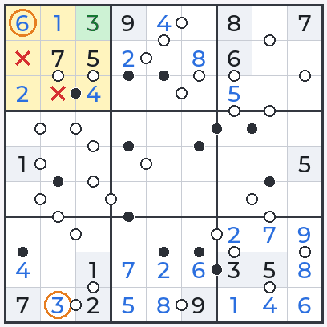

<!-- Written by tools/walkthrough.py kropki: edit the script, not this page. -->
# Kropki, step 23: the 3 in box 1

**Step 23 of 67** · [← Step 22](step-22.md) · [All steps](../kropki.md#the-whole-puzzle-step-by-step) · [Step 24 →](step-24.md)

Box 1 needs a 3. r3c2: column 2 has one (r9c2). r2c1: there's no dot between it and the 6 in r1c1: it isn't 3, 5 or 7. Only **r1c3** is left: **r1c3 = 3**.

**Step 23 of 67** · [← Step 22](step-22.md) · [All steps](../kropki.md#the-whole-puzzle-step-by-step) · [Step 24 →](step-24.md)
