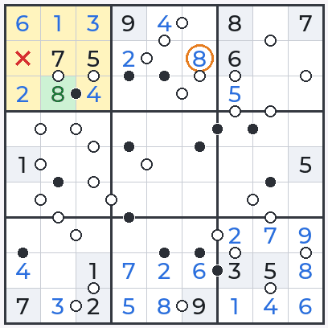

<!-- Written by tools/walkthrough.py kropki: edit the script, not this page. -->
# Kropki, step 24: the 8 in box 1

**Step 24 of 67** · [← Step 23](step-23.md) · [All steps](../kropki.md#the-whole-puzzle-step-by-step) · [Step 25 →](step-25.md)

Box 1 needs an 8. r2c1: row 2 has one (r2c6). Only **r3c2** is left: **r3c2 = 8**.

**Step 24 of 67** · [← Step 23](step-23.md) · [All steps](../kropki.md#the-whole-puzzle-step-by-step) · [Step 25 →](step-25.md)
