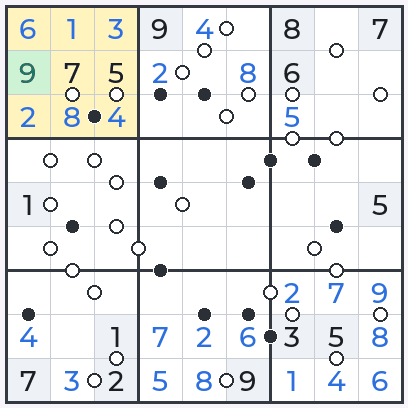

<!-- Written by tools/walkthrough.py kropki: edit the script, not this page. -->
# Kropki, step 25: the 9 in box 1

**Step 25 of 67** · [← Step 24](step-24.md) · [All steps](../kropki.md#the-whole-puzzle-step-by-step) · [Step 26 →](step-26.md)

Box 1 needs a 9, and r2c1 is its last empty cell: **r2c1 = 9**.

**Step 25 of 67** · [← Step 24](step-24.md) · [All steps](../kropki.md#the-whole-puzzle-step-by-step) · [Step 26 →](step-26.md)
