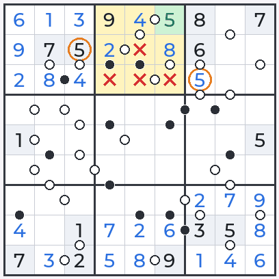

<!-- Written by tools/walkthrough.py kropki: edit the script, not this page. -->
# Kropki, step 26: the 5 in box 2

**Step 26 of 67** · [← Step 25](step-25.md) · [All steps](../kropki.md#the-whole-puzzle-step-by-step) · [Step 27 →](step-27.md)

Box 2 needs a 5. r2c5: row 2 has one (r2c3). r3c4, r3c5 and r3c6: row 3 has one (r3c7). Only **r1c6** is left: **r1c6 = 5**.

**Step 26 of 67** · [← Step 25](step-25.md) · [All steps](../kropki.md#the-whole-puzzle-step-by-step) · [Step 27 →](step-27.md)
