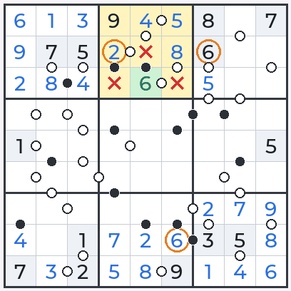

<!-- Written by tools/walkthrough.py kropki: edit the script, not this page. -->
# Kropki, step 27: the 6 in box 2

**Step 27 of 67** · [← Step 26](step-26.md) · [All steps](../kropki.md#the-whole-puzzle-step-by-step) · [Step 28 →](step-28.md)

Box 2 needs a 6. r2c5: row 2 has one (r2c7). r3c6: column 6 has one (r8c6). r3c4: a black dot joins it to the 2 in r2c4: it's 4 or 1. Only **r3c5** is left: **r3c5 = 6**.

**Step 27 of 67** · [← Step 26](step-26.md) · [All steps](../kropki.md#the-whole-puzzle-step-by-step) · [Step 28 →](step-28.md)
