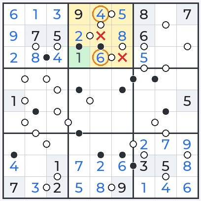

<!-- Written by tools/walkthrough.py kropki: edit the script, not this page. -->
# Kropki, step 28: the 1 in box 2

**Step 28 of 67** · [← Step 27](step-27.md) · [All steps](../kropki.md#the-whole-puzzle-step-by-step) · [Step 29 →](step-29.md)

Box 2 needs a 1. r2c5: a white dot joins it to the 4 in r1c5: it's 3 or 5. r3c6: a white dot joins it to the 6 in r3c5: it's 5 or 7. Only **r3c4** is left: **r3c4 = 1**.

**Step 28 of 67** · [← Step 27](step-27.md) · [All steps](../kropki.md#the-whole-puzzle-step-by-step) · [Step 29 →](step-29.md)
