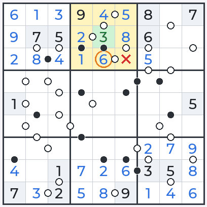

<!-- Written by tools/walkthrough.py kropki: edit the script, not this page. -->
# Kropki, step 29: the 3 in box 2

**Step 29 of 67** · [← Step 28](step-28.md) · [All steps](../kropki.md#the-whole-puzzle-step-by-step) · [Step 30 →](step-30.md)

Box 2 needs a 3. r3c6: a white dot joins it to the 6 in r3c5: it's 5 or 7. Only **r2c5** is left: **r2c5 = 3**.

**Step 29 of 67** · [← Step 28](step-28.md) · [All steps](../kropki.md#the-whole-puzzle-step-by-step) · [Step 30 →](step-30.md)
