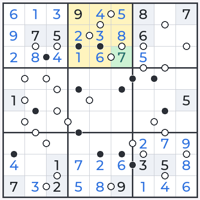

<!-- Written by tools/walkthrough.py kropki: edit the script, not this page. -->
# Kropki, step 30: the 7 in box 2

**Step 30 of 67** · [← Step 29](step-29.md) · [All steps](../kropki.md#the-whole-puzzle-step-by-step) · [Step 31 →](step-31.md)

Box 2 needs a 7, and r3c6 is its last empty cell: **r3c6 = 7**.

**Step 30 of 67** · [← Step 29](step-29.md) · [All steps](../kropki.md#the-whole-puzzle-step-by-step) · [Step 31 →](step-31.md)
