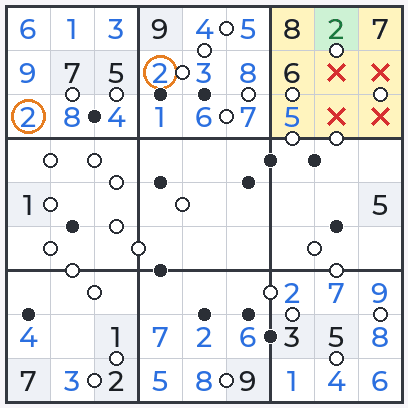

<!-- Written by tools/walkthrough.py kropki: edit the script, not this page. -->
# Kropki, step 31: the 2 in box 3

**Step 31 of 67** · [← Step 30](step-30.md) · [All steps](../kropki.md#the-whole-puzzle-step-by-step) · [Step 32 →](step-32.md)

Box 3 needs a 2. r2c8 and r2c9: row 2 has one (r2c4). r3c8 and r3c9: row 3 has one (r3c1). Only **r1c8** is left: **r1c8 = 2**.

**Step 31 of 67** · [← Step 30](step-30.md) · [All steps](../kropki.md#the-whole-puzzle-step-by-step) · [Step 32 →](step-32.md)
