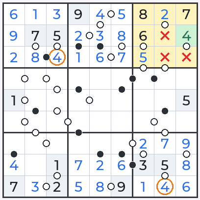

<!-- Written by tools/walkthrough.py kropki: edit the script, not this page. -->
# Kropki, step 32: the 4 in box 3

**Step 32 of 67** · [← Step 31](step-31.md) · [All steps](../kropki.md#the-whole-puzzle-step-by-step) · [Step 33 →](step-33.md)

Box 3 needs a 4. r2c8: column 8 has one (r9c8). r3c8 and r3c9: row 3 has one (r3c3). Only **r2c9** is left: **r2c9 = 4**.

**Step 32 of 67** · [← Step 31](step-31.md) · [All steps](../kropki.md#the-whole-puzzle-step-by-step) · [Step 33 →](step-33.md)
