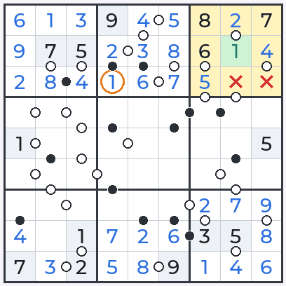

<!-- Written by tools/walkthrough.py kropki: edit the script, not this page. -->
# Kropki, step 33: the 1 in box 3

**Step 33 of 67** · [← Step 32](step-32.md) · [All steps](../kropki.md#the-whole-puzzle-step-by-step) · [Step 34 →](step-34.md)

Box 3 needs a 1. r3c8 and r3c9: row 3 has one (r3c4). Only **r2c8** is left: **r2c8 = 1**.

**Step 33 of 67** · [← Step 32](step-32.md) · [All steps](../kropki.md#the-whole-puzzle-step-by-step) · [Step 34 →](step-34.md)
