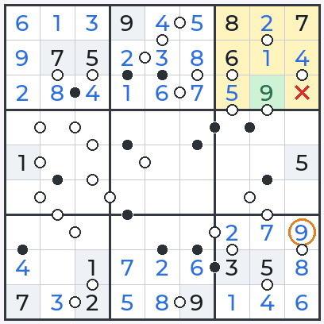

<!-- Written by tools/walkthrough.py kropki: edit the script, not this page. -->
# Kropki, step 34: the 9 in box 3

**Step 34 of 67** · [← Step 33](step-33.md) · [All steps](../kropki.md#the-whole-puzzle-step-by-step) · [Step 35 →](step-35.md)

Box 3 needs a 9. r3c9: column 9 has one (r7c9). Only **r3c8** is left: **r3c8 = 9**.

**Step 34 of 67** · [← Step 33](step-33.md) · [All steps](../kropki.md#the-whole-puzzle-step-by-step) · [Step 35 →](step-35.md)
