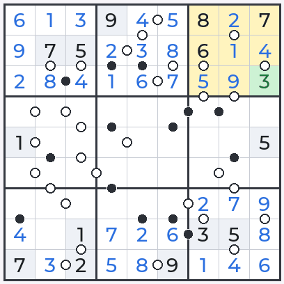

<!-- Written by tools/walkthrough.py kropki: edit the script, not this page. -->
# Kropki, step 35: the 3 in box 3

**Step 35 of 67** · [← Step 34](step-34.md) · [All steps](../kropki.md#the-whole-puzzle-step-by-step) · [Step 36 →](step-36.md)

Box 3 needs a 3, and r3c9 is its last empty cell: **r3c9 = 3**.

**Step 35 of 67** · [← Step 34](step-34.md) · [All steps](../kropki.md#the-whole-puzzle-step-by-step) · [Step 36 →](step-36.md)
