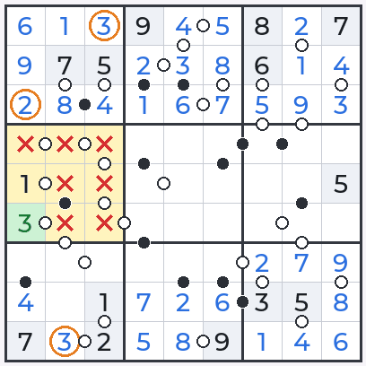

<!-- Written by tools/walkthrough.py kropki: edit the script, not this page. -->
# Kropki, step 36: the 3 in box 4

**Step 36 of 67** · [← Step 35](step-35.md) · [All steps](../kropki.md#the-whole-puzzle-step-by-step) · [Step 37 →](step-37.md)

Box 4 needs a 3. r4c2, r5c2 and r6c2: column 2 has one (r9c2). r4c3, r5c3 and r6c3: column 3 has one (r1c3). r4c1: there's no dot between it and the 2 in r3c1: it isn't 1, 3 or 4. Only **r6c1** is left: **r6c1 = 3**.

**Step 36 of 67** · [← Step 35](step-35.md) · [All steps](../kropki.md#the-whole-puzzle-step-by-step) · [Step 37 →](step-37.md)
