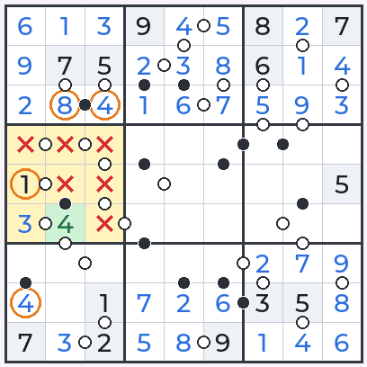

<!-- Written by tools/walkthrough.py kropki: edit the script, not this page. -->
# Kropki, step 37: the 4 in box 4

**Step 37 of 67** · [← Step 36](step-36.md) · [All steps](../kropki.md#the-whole-puzzle-step-by-step) · [Step 38 →](step-38.md)

Box 4 needs a 4. r4c1: column 1 has one (r8c1). r4c3, r5c3 and r6c3: column 3 has one (r3c3). r4c2: there's no dot between it and the 8 in r3c2: it isn't 4, 7 or 9. r5c2: a white dot joins it to the 1 in r5c1: it's 2. Only **r6c2** is left: **r6c2 = 4**.

**Step 37 of 67** · [← Step 36](step-36.md) · [All steps](../kropki.md#the-whole-puzzle-step-by-step) · [Step 38 →](step-38.md)
