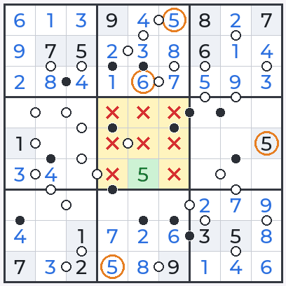

<!-- Written by tools/walkthrough.py kropki: edit the script, not this page. -->
# Kropki, step 38: the 5 in box 5

**Step 38 of 67** · [← Step 37](step-37.md) · [All steps](../kropki.md#the-whole-puzzle-step-by-step) · [Step 39 →](step-39.md)

Box 5 needs a 5. r4c4 and r6c4: column 4 has one (r9c4). r4c6 and r6c6: column 6 has one (r1c6). r5c4, r5c5 and r5c6: row 5 has one (r5c9). r4c5: there's no dot between it and the 6 in r3c5: it isn't 3, 5 or 7. Only **r6c5** is left: **r6c5 = 5**.

**Step 38 of 67** · [← Step 37](step-37.md) · [All steps](../kropki.md#the-whole-puzzle-step-by-step) · [Step 39 →](step-39.md)
