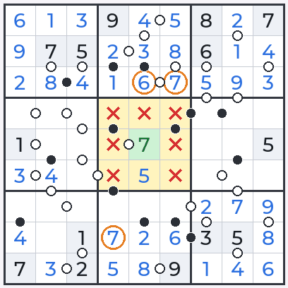

<!-- Written by tools/walkthrough.py kropki: edit the script, not this page. -->
# Kropki, step 39: the 7 in box 5

**Step 39 of 67** · [← Step 38](step-38.md) · [All steps](../kropki.md#the-whole-puzzle-step-by-step) · [Step 40 →](step-40.md)

Box 5 needs a 7. r4c4, r5c4 and r6c4: column 4 has one (r8c4). r4c6, r5c6 and r6c6: column 6 has one (r3c6). r4c5: there's no dot between it and the 6 in r3c5: it isn't 3, 5 or 7. Only **r5c5** is left: **r5c5 = 7**.

**Step 39 of 67** · [← Step 38](step-38.md) · [All steps](../kropki.md#the-whole-puzzle-step-by-step) · [Step 40 →](step-40.md)
