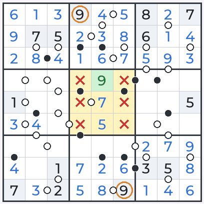

<!-- Written by tools/walkthrough.py kropki: edit the script, not this page. -->
# Kropki, step 40: the 9 in box 5

**Step 40 of 67** · [← Step 39](step-39.md) · [All steps](../kropki.md#the-whole-puzzle-step-by-step) · [Step 41 →](step-41.md)

Box 5 needs a 9. r4c4, r5c4 and r6c4: column 4 has one (r1c4). r4c6, r5c6 and r6c6: column 6 has one (r9c6). Only **r4c5** is left: **r4c5 = 9**.

**Step 40 of 67** · [← Step 39](step-39.md) · [All steps](../kropki.md#the-whole-puzzle-step-by-step) · [Step 41 →](step-41.md)
