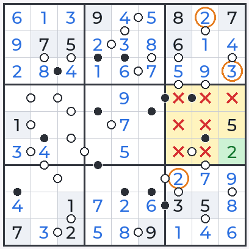

<!-- Written by tools/walkthrough.py kropki: edit the script, not this page. -->
# Kropki, step 41: the 2 in box 6

**Step 41 of 67** · [← Step 40](step-40.md) · [All steps](../kropki.md#the-whole-puzzle-step-by-step) · [Step 42 →](step-42.md)

Box 6 needs a 2. r4c7, r5c7 and r6c7: column 7 has one (r7c7). r4c8, r5c8 and r6c8: column 8 has one (r1c8). r4c9: there's no dot between it and the 3 in r3c9: it isn't 2, 4 or 6. Only **r6c9** is left: **r6c9 = 2**.

**Step 41 of 67** · [← Step 40](step-40.md) · [All steps](../kropki.md#the-whole-puzzle-step-by-step) · [Step 42 →](step-42.md)
