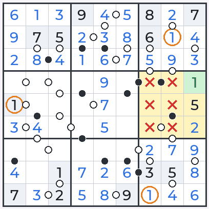

<!-- Written by tools/walkthrough.py kropki: edit the script, not this page. -->
# Kropki, step 42: the 1 in box 6

**Step 42 of 67** · [← Step 41](step-41.md) · [All steps](../kropki.md#the-whole-puzzle-step-by-step) · [Step 43 →](step-43.md)

Box 6 needs a 1. r4c7 and r6c7: column 7 has one (r9c7). r4c8 and r6c8: column 8 has one (r2c8). r5c7 and r5c8: row 5 has one (r5c1). Only **r4c9** is left: **r4c9 = 1**.

**Step 42 of 67** · [← Step 41](step-41.md) · [All steps](../kropki.md#the-whole-puzzle-step-by-step) · [Step 43 →](step-43.md)
