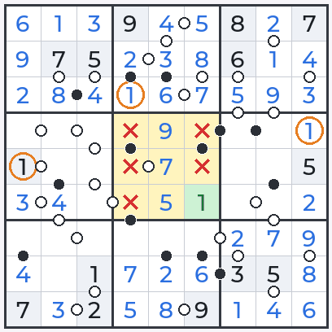

<!-- Written by tools/walkthrough.py kropki: edit the script, not this page. -->
# Kropki, step 43: the 1 in box 5

**Step 43 of 67** · [← Step 42](step-42.md) · [All steps](../kropki.md#the-whole-puzzle-step-by-step) · [Step 44 →](step-44.md)

Box 5 needs a 1. r4c4 and r4c6: row 4 has one (r4c9). r5c4 and r5c6: row 5 has one (r5c1). r6c4: column 4 has one (r3c4). Only **r6c6** is left: **r6c6 = 1**.

**Step 43 of 67** · [← Step 42](step-42.md) · [All steps](../kropki.md#the-whole-puzzle-step-by-step) · [Step 44 →](step-44.md)
