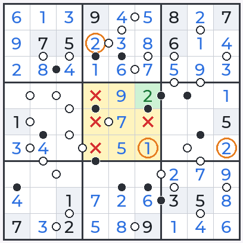

<!-- Written by tools/walkthrough.py kropki: edit the script, not this page. -->
# Kropki, step 44: the 2 in box 5

**Step 44 of 67** · [← Step 43](step-43.md) · [All steps](../kropki.md#the-whole-puzzle-step-by-step) · [Step 45 →](step-45.md)

Box 5 needs a 2. r4c4 and r5c4: column 4 has one (r2c4). r6c4: row 6 has one (r6c9). r5c6: there's no dot between it and the 1 in r6c6: it isn't 2. Only **r4c6** is left: **r4c6 = 2**.

**Step 44 of 67** · [← Step 43](step-43.md) · [All steps](../kropki.md#the-whole-puzzle-step-by-step) · [Step 45 →](step-45.md)
