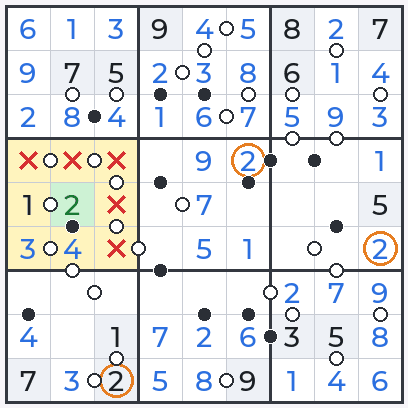

<!-- Written by tools/walkthrough.py kropki: edit the script, not this page. -->
# Kropki, step 45: the 2 in box 4

**Step 45 of 67** · [← Step 44](step-44.md) · [All steps](../kropki.md#the-whole-puzzle-step-by-step) · [Step 46 →](step-46.md)

Box 4 needs a 2. r4c1, r4c2 and r4c3: row 4 has one (r4c6). r5c3: column 3 has one (r9c3). r6c3: row 6 has one (r6c9). Only **r5c2** is left: **r5c2 = 2**.

**Step 45 of 67** · [← Step 44](step-44.md) · [All steps](../kropki.md#the-whole-puzzle-step-by-step) · [Step 46 →](step-46.md)
