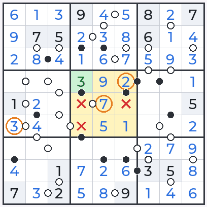

<!-- Written by tools/walkthrough.py kropki: edit the script, not this page. -->
# Kropki, step 46: the 3 in box 5

**Step 46 of 67** · [← Step 45](step-45.md) · [All steps](../kropki.md#the-whole-puzzle-step-by-step) · [Step 47 →](step-47.md)

Box 5 needs a 3. r6c4: row 6 has one (r6c1). r5c4: a white dot joins it to the 7 in r5c5: it's 6 or 8. r5c6: a black dot joins it to the 2 in r4c6: it's 4 or 1. Only **r4c4** is left: **r4c4 = 3**.

**Step 46 of 67** · [← Step 45](step-45.md) · [All steps](../kropki.md#the-whole-puzzle-step-by-step) · [Step 47 →](step-47.md)
