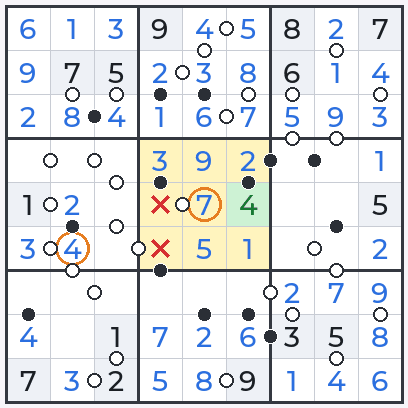

<!-- Written by tools/walkthrough.py kropki: edit the script, not this page. -->
# Kropki, step 47: the 4 in box 5

**Step 47 of 67** · [← Step 46](step-46.md) · [All steps](../kropki.md#the-whole-puzzle-step-by-step) · [Step 48 →](step-48.md)

Box 5 needs a 4. r6c4: row 6 has one (r6c2). r5c4: a white dot joins it to the 7 in r5c5: it's 6 or 8. Only **r5c6** is left: **r5c6 = 4**.

**Step 47 of 67** · [← Step 46](step-46.md) · [All steps](../kropki.md#the-whole-puzzle-step-by-step) · [Step 48 →](step-48.md)
