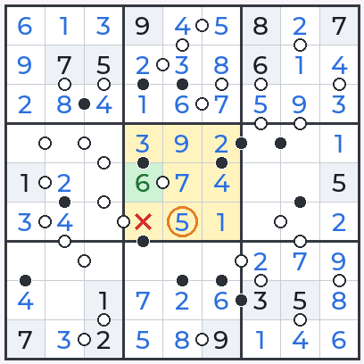

<!-- Written by tools/walkthrough.py kropki: edit the script, not this page. -->
# Kropki, step 48: the 6 in box 5

**Step 48 of 67** · [← Step 47](step-47.md) · [All steps](../kropki.md#the-whole-puzzle-step-by-step) · [Step 49 →](step-49.md)

Box 5 needs a 6. r6c4: there's no dot between it and the 5 in r6c5: it isn't 4 or 6. Only **r5c4** is left: **r5c4 = 6**.

**Step 48 of 67** · [← Step 47](step-47.md) · [All steps](../kropki.md#the-whole-puzzle-step-by-step) · [Step 49 →](step-49.md)
