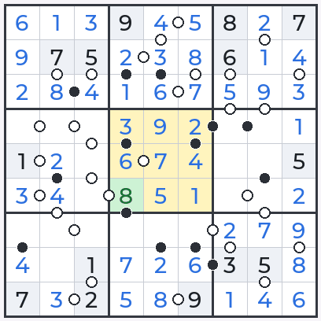

<!-- Written by tools/walkthrough.py kropki: edit the script, not this page. -->
# Kropki, step 49: the 8 in box 5

**Step 49 of 67** · [← Step 48](step-48.md) · [All steps](../kropki.md#the-whole-puzzle-step-by-step) · [Step 50 →](step-50.md)

Box 5 needs an 8, and r6c4 is its last empty cell: **r6c4 = 8**.

**Step 49 of 67** · [← Step 48](step-48.md) · [All steps](../kropki.md#the-whole-puzzle-step-by-step) · [Step 50 →](step-50.md)
