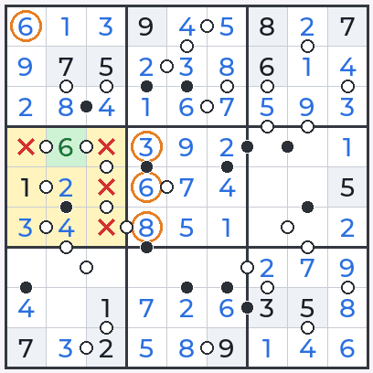

<!-- Written by tools/walkthrough.py kropki: edit the script, not this page. -->
# Kropki, step 50: the 6 in box 4

**Step 50 of 67** · [← Step 49](step-49.md) · [All steps](../kropki.md#the-whole-puzzle-step-by-step) · [Step 51 →](step-51.md)

Box 4 needs a 6. r4c1: column 1 has one (r1c1). r5c3: row 5 has one (r5c4). r4c3: there's no dot between it and the 3 in r4c4: it isn't 2, 4 or 6. r6c3: a white dot joins it to the 8 in r6c4: it's 7 or 9. Only **r4c2** is left: **r4c2 = 6**.

**Step 50 of 67** · [← Step 49](step-49.md) · [All steps](../kropki.md#the-whole-puzzle-step-by-step) · [Step 51 →](step-51.md)
