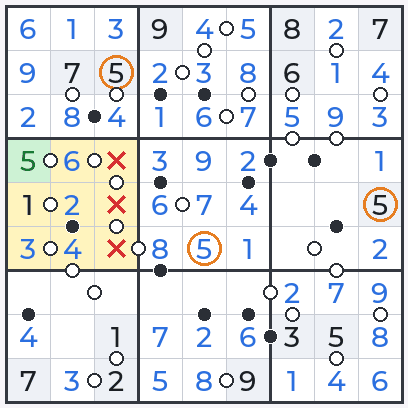

<!-- Written by tools/walkthrough.py kropki: edit the script, not this page. -->
# Kropki, step 51: the 5 in box 4

**Step 51 of 67** · [← Step 50](step-50.md) · [All steps](../kropki.md#the-whole-puzzle-step-by-step) · [Step 52 →](step-52.md)

Box 4 needs a 5. r4c3: column 3 has one (r2c3). r5c3: row 5 has one (r5c9). r6c3: row 6 has one (r6c5). Only **r4c1** is left: **r4c1 = 5**.

**Step 51 of 67** · [← Step 50](step-50.md) · [All steps](../kropki.md#the-whole-puzzle-step-by-step) · [Step 52 →](step-52.md)
