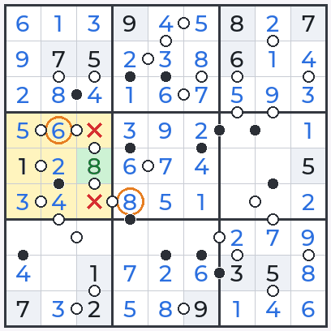

<!-- Written by tools/walkthrough.py kropki: edit the script, not this page. -->
# Kropki, step 52: the 8 in box 4

**Step 52 of 67** · [← Step 51](step-51.md) · [All steps](../kropki.md#the-whole-puzzle-step-by-step) · [Step 53 →](step-53.md)

Box 4 needs an 8. r6c3: row 6 has one (r6c4). r4c3: a white dot joins it to the 6 in r4c2: it's 5 or 7. Only **r5c3** is left: **r5c3 = 8**.

**Step 52 of 67** · [← Step 51](step-51.md) · [All steps](../kropki.md#the-whole-puzzle-step-by-step) · [Step 53 →](step-53.md)
