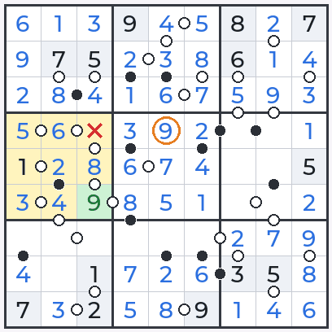

<!-- Written by tools/walkthrough.py kropki: edit the script, not this page. -->
# Kropki, step 53: the 9 in box 4

**Step 53 of 67** · [← Step 52](step-52.md) · [All steps](../kropki.md#the-whole-puzzle-step-by-step) · [Step 54 →](step-54.md)

Box 4 needs a 9. r4c3: row 4 has one (r4c5). Only **r6c3** is left: **r6c3 = 9**.

**Step 53 of 67** · [← Step 52](step-52.md) · [All steps](../kropki.md#the-whole-puzzle-step-by-step) · [Step 54 →](step-54.md)
