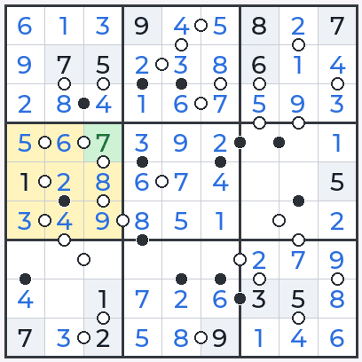

<!-- Written by tools/walkthrough.py kropki: edit the script, not this page. -->
# Kropki, step 54: the 7 in box 4

**Step 54 of 67** · [← Step 53](step-53.md) · [All steps](../kropki.md#the-whole-puzzle-step-by-step) · [Step 55 →](step-55.md)

Box 4 needs a 7, and r4c3 is its last empty cell: **r4c3 = 7**.

**Step 54 of 67** · [← Step 53](step-53.md) · [All steps](../kropki.md#the-whole-puzzle-step-by-step) · [Step 55 →](step-55.md)
