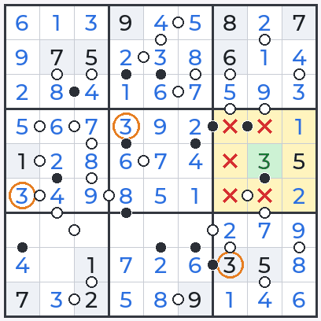

<!-- Written by tools/walkthrough.py kropki: edit the script, not this page. -->
# Kropki, step 55: the 3 in box 6

**Step 55 of 67** · [← Step 54](step-54.md) · [All steps](../kropki.md#the-whole-puzzle-step-by-step) · [Step 56 →](step-56.md)

Box 6 needs a 3. r4c7 and r4c8: row 4 has one (r4c4). r5c7: column 7 has one (r8c7). r6c7 and r6c8: row 6 has one (r6c1). Only **r5c8** is left: **r5c8 = 3**.

**Step 55 of 67** · [← Step 54](step-54.md) · [All steps](../kropki.md#the-whole-puzzle-step-by-step) · [Step 56 →](step-56.md)
