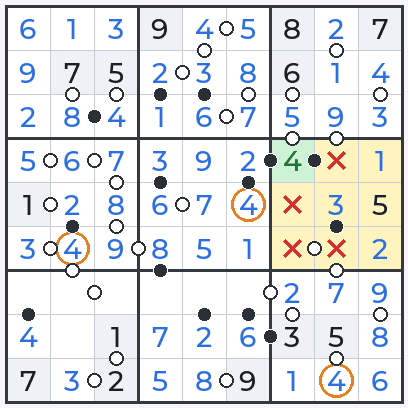

<!-- Written by tools/walkthrough.py kropki: edit the script, not this page. -->
# Kropki, step 56: the 4 in box 6

**Step 56 of 67** · [← Step 55](step-55.md) · [All steps](../kropki.md#the-whole-puzzle-step-by-step) · [Step 57 →](step-57.md)

Box 6 needs a 4. r4c8: column 8 has one (r9c8). r5c7: row 5 has one (r5c6). r6c7 and r6c8: row 6 has one (r6c2). Only **r4c7** is left: **r4c7 = 4**.

**Step 56 of 67** · [← Step 55](step-55.md) · [All steps](../kropki.md#the-whole-puzzle-step-by-step) · [Step 57 →](step-57.md)
