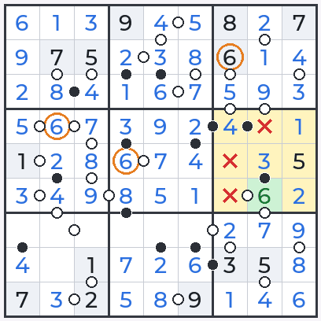

<!-- Written by tools/walkthrough.py kropki: edit the script, not this page. -->
# Kropki, step 57: the 6 in box 6

**Step 57 of 67** · [← Step 56](step-56.md) · [All steps](../kropki.md#the-whole-puzzle-step-by-step) · [Step 58 →](step-58.md)

Box 6 needs a 6. r4c8: row 4 has one (r4c2). r5c7: row 5 has one (r5c4). r6c7: column 7 has one (r2c7). Only **r6c8** is left: **r6c8 = 6**.

**Step 57 of 67** · [← Step 56](step-56.md) · [All steps](../kropki.md#the-whole-puzzle-step-by-step) · [Step 58 →](step-58.md)
