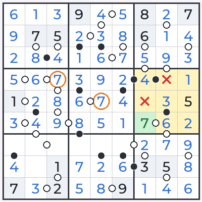

<!-- Written by tools/walkthrough.py kropki: edit the script, not this page. -->
# Kropki, step 58: the 7 in box 6

**Step 58 of 67** · [← Step 57](step-57.md) · [All steps](../kropki.md#the-whole-puzzle-step-by-step) · [Step 59 →](step-59.md)

Box 6 needs a 7. r4c8: row 4 has one (r4c3). r5c7: row 5 has one (r5c5). Only **r6c7** is left: **r6c7 = 7**.

**Step 58 of 67** · [← Step 57](step-57.md) · [All steps](../kropki.md#the-whole-puzzle-step-by-step) · [Step 59 →](step-59.md)
