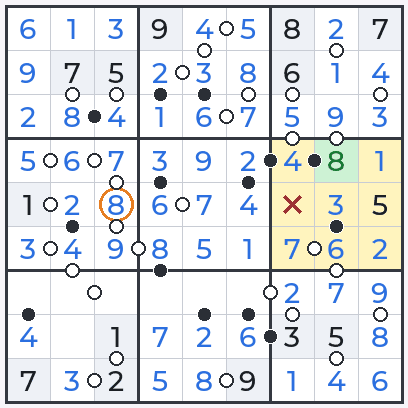

<!-- Written by tools/walkthrough.py kropki: edit the script, not this page. -->
# Kropki, step 59: the 8 in box 6

**Step 59 of 67** · [← Step 58](step-58.md) · [All steps](../kropki.md#the-whole-puzzle-step-by-step) · [Step 60 →](step-60.md)

Box 6 needs an 8. r5c7: row 5 has one (r5c3). Only **r4c8** is left: **r4c8 = 8**.

**Step 59 of 67** · [← Step 58](step-58.md) · [All steps](../kropki.md#the-whole-puzzle-step-by-step) · [Step 60 →](step-60.md)
