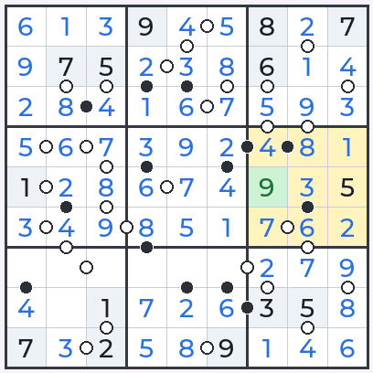

<!-- Written by tools/walkthrough.py kropki: edit the script, not this page. -->
# Kropki, step 60: the 9 in box 6

**Step 60 of 67** · [← Step 59](step-59.md) · [All steps](../kropki.md#the-whole-puzzle-step-by-step) · [Step 61 →](step-61.md)

Box 6 needs a 9, and r5c7 is its last empty cell: **r5c7 = 9**.

**Step 60 of 67** · [← Step 59](step-59.md) · [All steps](../kropki.md#the-whole-puzzle-step-by-step) · [Step 61 →](step-61.md)
