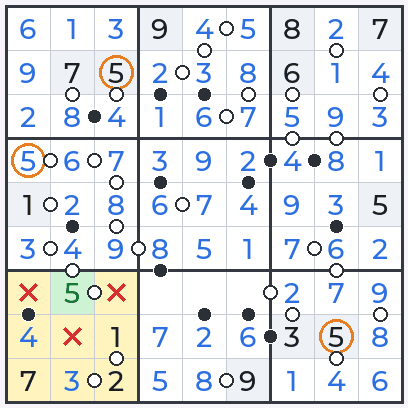

<!-- Written by tools/walkthrough.py kropki: edit the script, not this page. -->
# Kropki, step 61: the 5 in box 7

**Step 61 of 67** · [← Step 60](step-60.md) · [All steps](../kropki.md#the-whole-puzzle-step-by-step) · [Step 62 →](step-62.md)

Box 7 needs a 5. r7c1: column 1 has one (r4c1). r7c3: column 3 has one (r2c3). r8c2: row 8 has one (r8c8). Only **r7c2** is left: **r7c2 = 5**.

**Step 61 of 67** · [← Step 60](step-60.md) · [All steps](../kropki.md#the-whole-puzzle-step-by-step) · [Step 62 →](step-62.md)
