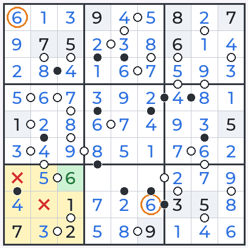

<!-- Written by tools/walkthrough.py kropki: edit the script, not this page. -->
# Kropki, step 62: the 6 in box 7

**Step 62 of 67** · [← Step 61](step-61.md) · [All steps](../kropki.md#the-whole-puzzle-step-by-step) · [Step 63 →](step-63.md)

Box 7 needs a 6. r7c1: column 1 has one (r1c1). r8c2: row 8 has one (r8c6). Only **r7c3** is left: **r7c3 = 6**.

**Step 62 of 67** · [← Step 61](step-61.md) · [All steps](../kropki.md#the-whole-puzzle-step-by-step) · [Step 63 →](step-63.md)
