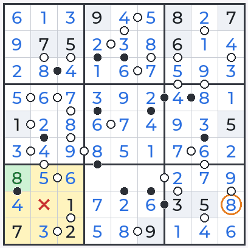

<!-- Written by tools/walkthrough.py kropki: edit the script, not this page. -->
# Kropki, step 63: the 8 in box 7

**Step 63 of 67** · [← Step 62](step-62.md) · [All steps](../kropki.md#the-whole-puzzle-step-by-step) · [Step 64 →](step-64.md)

Box 7 needs an 8. r8c2: row 8 has one (r8c9). Only **r7c1** is left: **r7c1 = 8**.

**Step 63 of 67** · [← Step 62](step-62.md) · [All steps](../kropki.md#the-whole-puzzle-step-by-step) · [Step 64 →](step-64.md)
