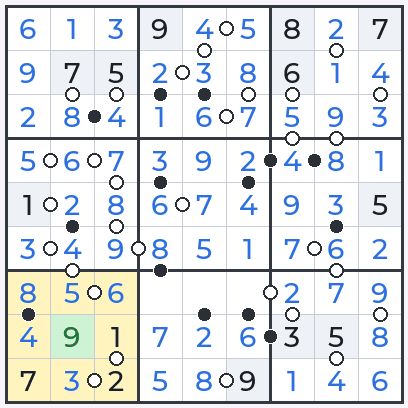

<!-- Written by tools/walkthrough.py kropki: edit the script, not this page. -->
# Kropki, step 64: the 9 in box 7

**Step 64 of 67** · [← Step 63](step-63.md) · [All steps](../kropki.md#the-whole-puzzle-step-by-step) · [Step 65 →](step-65.md)

Box 7 needs a 9, and r8c2 is its last empty cell: **r8c2 = 9**.

**Step 64 of 67** · [← Step 63](step-63.md) · [All steps](../kropki.md#the-whole-puzzle-step-by-step) · [Step 65 →](step-65.md)
