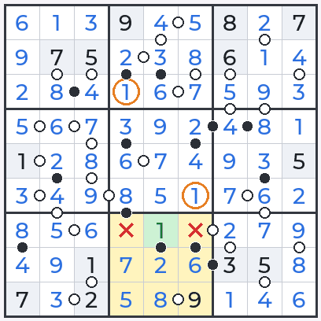

<!-- Written by tools/walkthrough.py kropki: edit the script, not this page. -->
# Kropki, step 65: the 1 in box 8

**Step 65 of 67** · [← Step 64](step-64.md) · [All steps](../kropki.md#the-whole-puzzle-step-by-step) · [Step 66 →](step-66.md)

Box 8 needs a 1. r7c4: column 4 has one (r3c4). r7c6: column 6 has one (r6c6). Only **r7c5** is left: **r7c5 = 1**.

**Step 65 of 67** · [← Step 64](step-64.md) · [All steps](../kropki.md#the-whole-puzzle-step-by-step) · [Step 66 →](step-66.md)
