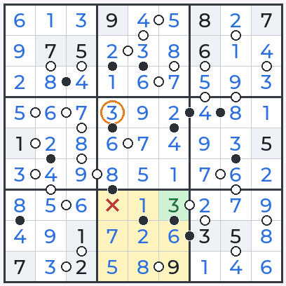

<!-- Written by tools/walkthrough.py kropki: edit the script, not this page. -->
# Kropki, step 66: the 3 in box 8

**Step 66 of 67** · [← Step 65](step-65.md) · [All steps](../kropki.md#the-whole-puzzle-step-by-step) · [Step 67 →](step-67.md)

Box 8 needs a 3. r7c4: column 4 has one (r4c4). Only **r7c6** is left: **r7c6 = 3**.

**Step 66 of 67** · [← Step 65](step-65.md) · [All steps](../kropki.md#the-whole-puzzle-step-by-step) · [Step 67 →](step-67.md)
