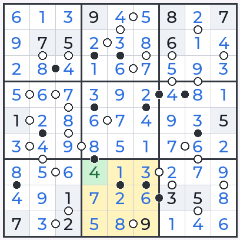

<!-- Written by tools/walkthrough.py kropki: edit the script, not this page. -->
# Kropki, step 67: the 4 in box 8

**Step 67 of 67** · [← Step 66](step-66.md) · [All steps](../kropki.md#the-whole-puzzle-step-by-step) · [All steps](../kropki.md#the-whole-puzzle-step-by-step)

Box 8 needs a 4, and r7c4 is its last empty cell: **r7c4 = 4**.

Solved.

**Step 67 of 67** · [← Step 66](step-66.md) · [All steps](../kropki.md#the-whole-puzzle-step-by-step) · [All steps](../kropki.md#the-whole-puzzle-step-by-step)
