# Little Killer

[← All variants](README.md) · [Puzzles](../features-puzzles.md) · [How to play](../how-to-play.md)

## The rules

[Classic](classic.md) rules, and **clues outside the grid with a small arrow**: the **sum of the digits along that diagonal**, all the way to the edge. Digits **can repeat** on a diagonal (where the boxes allow it): unlike a Killer cage, a diagonal isn't a group of different digits.

## On the board

- Each clue is a small blue sum on the line between two cells, above the columns or left of the rows, with an arrow pointing into its diagonal's first cell: down-right or down-left from the top, down-right or up-right from the left.
- A diagonal whose digits add up to more than its clue, or (full) to anything else, turns red.
- The grader and hints narrow each cell of a diagonal by what its other cells can add up to: "This diagonal adds up to 34, so row 1, column 3 can only be 9".
- **Puzzles → ⋮ → New puzzle → Little Killer**: 8 diagonals (Hard and Expert 10) of 3 cells or more.

## How to solve it

- **Short diagonals first:** a diagonal of 3 cells adds up to at most 27 and at least 3 (with repeats), so a big or small sum pins its cells down.
- **Big sums need big digits:** with a sum of 34 over seven cells and only 3 placed, the rest must average high; a small digit can be impossible.
- **Repeats are allowed,** so don't use Killer's "different digits" combinations, only the sum: a diagonal of 3 with 27 is 9, 9, 9.
- When all cells but one are known, the last one is the sum minus the rest.

## Worked example

**variant-examples #25**, Little Killer Easy (see [Classic](classic.md#worked-example-the-whole-puzzle) for how to import the examples; cells are written r*row*c*column*). The clues are in the screenshot; one matters here: **34** above column 3, pointing down-right, along r1c3, r2c4, r3c5, r4c6, r5c7, r6c8 and r7c9.

**Step 1: r1c3, at the head of the 34.** Row 1 has 4 and 5; column 3 has 1, 2, 6 and 8; box 1 has 7. By the Classic rules r1c3 could be 3 or 9. Now the diagonal: r2c4, r4c6 and r5c7 are all 1s (repeats are fine here, they're in different boxes): 3 so far. If r1c3 were 3, its three other empty cells (r3c5, r6c8, r7c9) would have to make 34 − 3 − 3 = 28, and three digits make at most 27. **r1c3 = 9**.

**Step 2: the 8 in box 1.** Rows 2 and 3 have an 8 (r2c7, r3c4), and so does column 1 (r4c1): that rules out r2c2, r2c3, r3c1, r3c3 and r1c1. **r1c2 = 8**.

**Step 3: the 1 in box 1.** Rows 2 and 3 have a 1 (r2c4, r3c8): r2c2, r2c3, r3c1 and r3c3 are out. **r1c1 = 1**.

## The whole puzzle, step by step

<!-- walkthrough -->
<!-- Written by tools/walkthrough.py little-killer: edit the script, not this part. -->

The whole puzzle, from the start to the last cell: 49 steps, each one a single (one place left for a digit, or one digit left for a cell), taken in the order a box's single comes first, so not quite the order of the worked example above. In each picture, the unit the step looks at is tinted yellow (for a cell with one digit left: its row, column and box), the new digit is on green, the digits that rule cells out have an **orange ring**, and the empty cells they rule out a **red cross**. Givens are on grey, digits from earlier steps in blue.

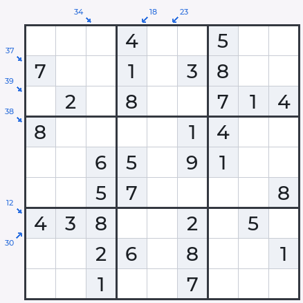

#### Step 1: the 8 in box 1

Box 1 needs an 8. r1c1: column 1 has one (r4c1). r1c3: column 3 has one (r7c3). r2c2 and r2c3: row 2 has one (r2c7). r3c1 and r3c3: row 3 has one (r3c4). Only **r1c2** is left: **r1c2 = 8**.

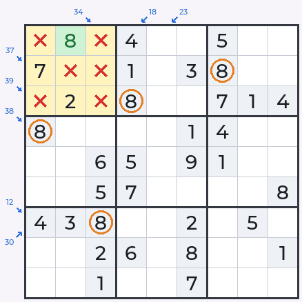

#### Step 2: the 1 in box 1

Box 1 needs a 1. r1c3: column 3 has one (r9c3). r2c2 and r2c3: row 2 has one (r2c4). r3c1 and r3c3: row 3 has one (r3c8). Only **r1c1** is left: **r1c1 = 1**.

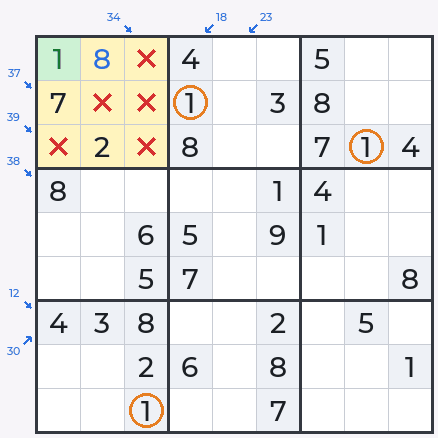

#### Step 3: the 7 in box 2

Box 2 needs a 7. r1c6: column 6 has one (r9c6). r2c5: row 2 has one (r2c1). r3c5 and r3c6: row 3 has one (r3c7). Only **r1c5** is left: **r1c5 = 7**.

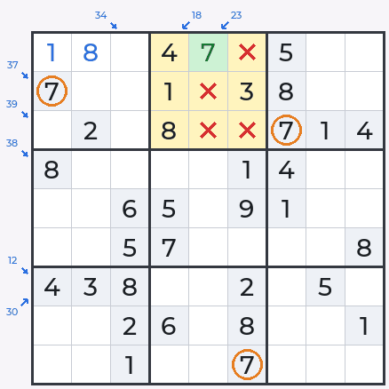

#### Step 4: the 2 in box 2

Box 2 needs a 2. r1c6: column 6 has one (r7c6). r3c5 and r3c6: row 3 has one (r3c2). Only **r2c5** is left: **r2c5 = 2**.

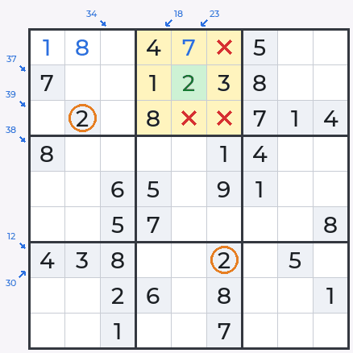

#### Step 5: the 9 in box 2

Box 2 needs a 9. r1c6 and r3c6: column 6 has one (r5c6). Only **r3c5** is left: **r3c5 = 9**.

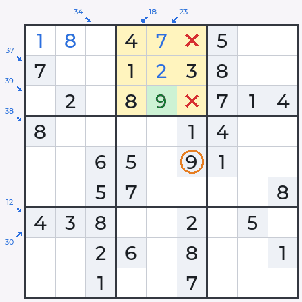

#### Step 6: the 5 in box 2

Box 2 needs a 5. r1c6: row 1 has one (r1c7). Only **r3c6** is left: **r3c6 = 5**.

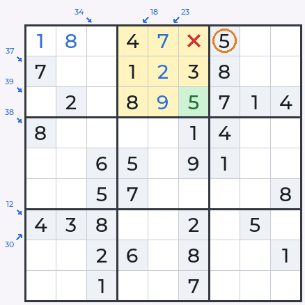

#### Step 7: the 5 in box 1

Box 1 needs a 5. r1c3: row 1 has one (r1c7). r2c3: column 3 has one (r6c3). r3c1 and r3c3: row 3 has one (r3c6). Only **r2c2** is left: **r2c2 = 5**.

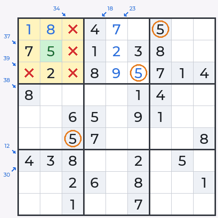

#### Step 8: the 4 in box 1

Box 1 needs a 4. r1c3: row 1 has one (r1c4). r3c1 and r3c3: row 3 has one (r3c9). Only **r2c3** is left: **r2c3 = 4**.

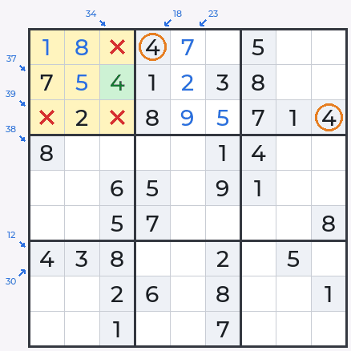

#### Step 9: the 6 in box 1

Box 1 needs a 6. r1c3 and r3c3: column 3 has one (r5c3). Only **r3c1** is left: **r3c1 = 6**.

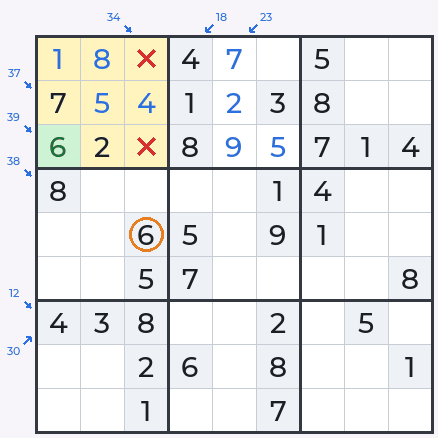

#### Step 10: the 3 in box 1

Box 1 needs a 3. r1c3: on its diagonal of 34 (with 1, 9, 1 and 1 already on it), a 3 would leave 19 for its other 2 cells, too much. Only **r3c3** is left: **r3c3 = 3**.

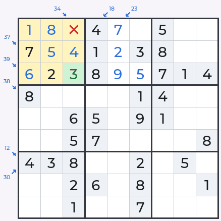

#### Step 11: the 9 in box 1

Box 1 needs a 9, and r1c3 is its last empty cell: **r1c3 = 9**.

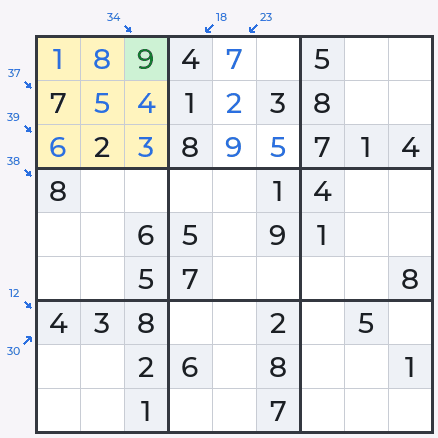

#### Step 12: the 6 in box 2

Box 2 needs a 6, and r1c6 is its last empty cell: **r1c6 = 6**.

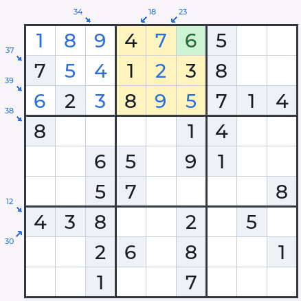

#### Step 13: the 1 in box 4

Box 4 needs a 1. r4c2 and r4c3: row 4 has one (r4c6). r5c1 and r5c2: row 5 has one (r5c7). r6c1: column 1 has one (r1c1). Only **r6c2** is left: **r6c2 = 1**.

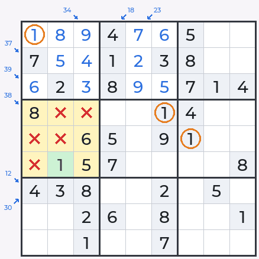

#### Step 14: the 2 in box 4

Box 4 needs a 2. r4c2 and r5c2: column 2 has one (r3c2). r4c3: column 3 has one (r8c3). r5c1: on its diagonal of 23 (with 7, 1 and 3 already on it), a 2 would leave 10 for its other cell, too much. Only **r6c1** is left: **r6c1 = 2**.

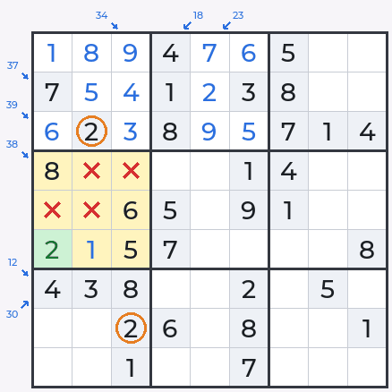

#### Step 15: the 3 in box 4

Box 4 needs a 3. r4c2 and r5c2: column 2 has one (r7c2). r4c3: column 3 has one (r3c3). Only **r5c1** is left: **r5c1 = 3**.

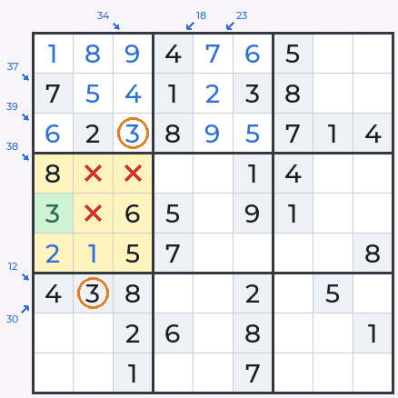

#### Step 16: the 4 in box 4

Box 4 needs a 4. r4c2 and r4c3: row 4 has one (r4c7). Only **r5c2** is left: **r5c2 = 4**.

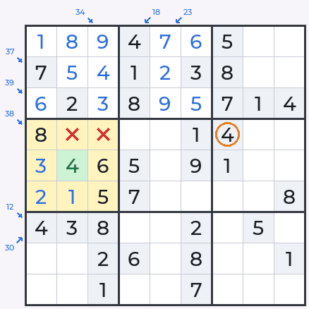

#### Step 17: the 7 in box 4

Box 4 needs a 7. r4c2: its diagonal of 23 (with 7, 1, 3 and 3 already on it) needs 9 there. Only **r4c3** is left: **r4c3 = 7**.

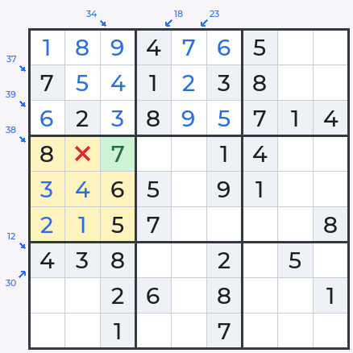

#### Step 18: the 9 in box 4

Box 4 needs a 9, and r4c2 is its last empty cell: **r4c2 = 9**.

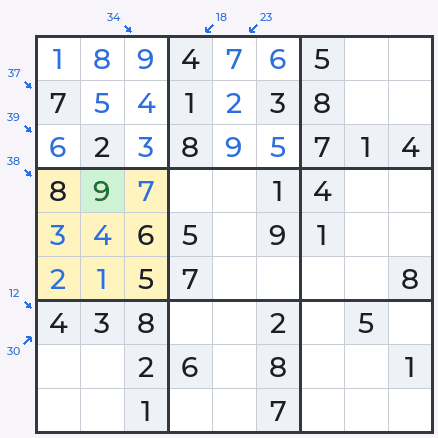

#### Step 19: the 2 in box 5

Box 5 needs a 2. r4c5 and r5c5: column 5 has one (r2c5). r6c5 and r6c6: row 6 has one (r6c1). Only **r4c4** is left: **r4c4 = 2**.

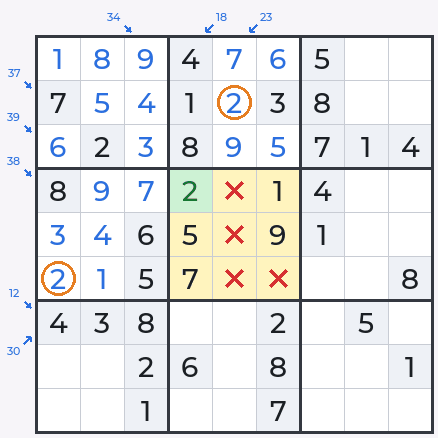

#### Step 20: the 8 in box 5

Box 5 needs an 8. r4c5: row 4 has one (r4c1). r6c5 and r6c6: row 6 has one (r6c9). Only **r5c5** is left: **r5c5 = 8**.

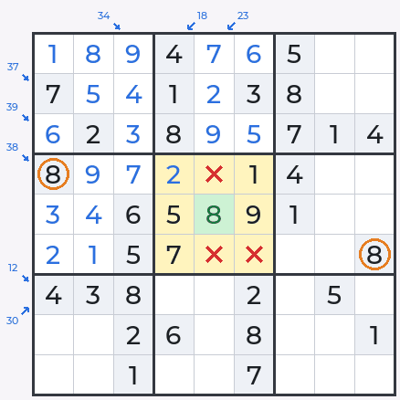

#### Step 21: the 5 in box 6

Box 6 needs a 5. r4c8: column 8 has one (r7c8). r5c8 and r5c9: row 5 has one (r5c4). r6c7 and r6c8: row 6 has one (r6c3). Only **r4c9** is left: **r4c9 = 5**.

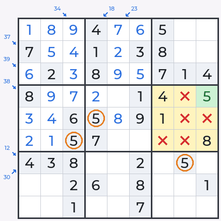

#### Step 22: the 6 in box 7

Box 7 needs a 6. r8c1 and r8c2: row 8 has one (r8c4). r9c1: column 1 has one (r3c1). Only **r9c2** is left: **r9c2 = 6**.

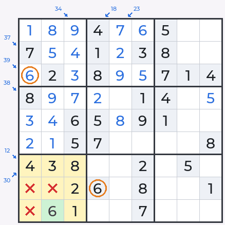

#### Step 23: the 7 in box 7

Box 7 needs a 7. r8c1: column 1 has one (r2c1). r9c1: row 9 has one (r9c6). Only **r8c2** is left: **r8c2 = 7**.

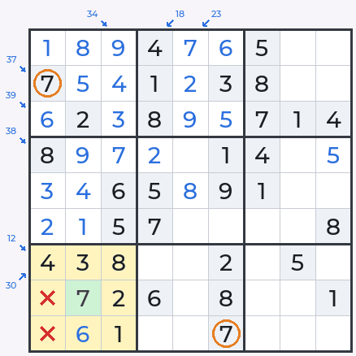

#### Step 24: the 1 in box 8

Box 8 needs a 1. r7c4: column 4 has one (r2c4). r8c5: row 8 has one (r8c9). r9c4 and r9c5: row 9 has one (r9c3). Only **r7c5** is left: **r7c5 = 1**.

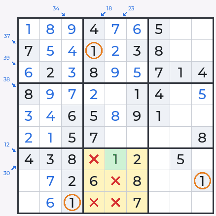

#### Step 25: the 4 in box 8

Box 8 needs a 4. r7c4: row 7 has one (r7c1). r9c4: column 4 has one (r1c4). r8c5: on its diagonal of 38 (with 8, 4, 5 and 7 already on it), a 4 would leave 10 for its other cell, too much. Only **r9c5** is left: **r9c5 = 4**.

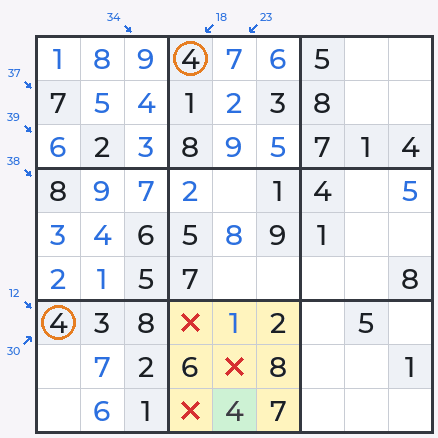

#### Step 26: the 4 in box 5

Box 5 needs a 4. r4c5: row 4 has one (r4c7). r6c5: column 5 has one (r9c5). Only **r6c6** is left: **r6c6 = 4**.

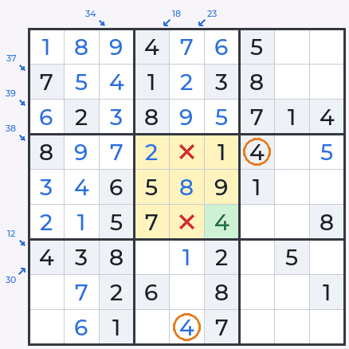

#### Step 27: the 3 in box 8

Box 8 needs a 3. r7c4: row 7 has one (r7c2). r8c5: on its diagonal of 38 (with 8, 4, 5 and 7 already on it), a 3 would leave 11 for its other cell, too much. Only **r9c4** is left: **r9c4 = 3**.

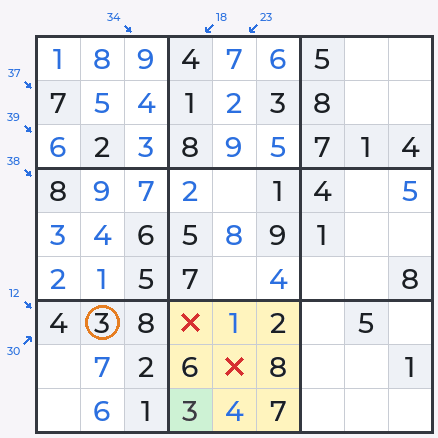

#### Step 28: the 5 in box 8

Box 8 needs a 5. r7c4: row 7 has one (r7c8). Only **r8c5** is left: **r8c5 = 5**.

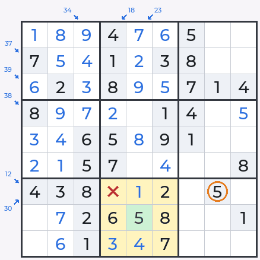

#### Step 29: the 5 in box 7

Box 7 needs a 5. r8c1: row 8 has one (r8c5). Only **r9c1** is left: **r9c1 = 5**.

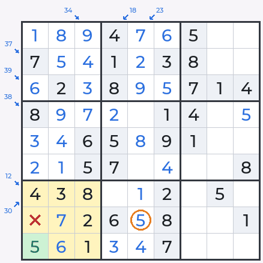

#### Step 30: the 9 in box 7

Box 7 needs a 9, and r8c1 is its last empty cell: **r8c1 = 9**.

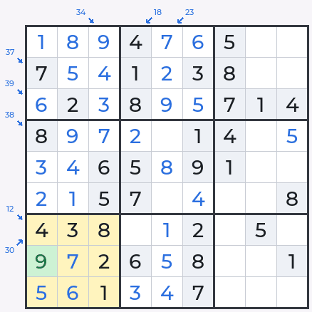

#### Step 31: the 9 in box 8

Box 8 needs a 9, and r7c4 is its last empty cell: **r7c4 = 9**.

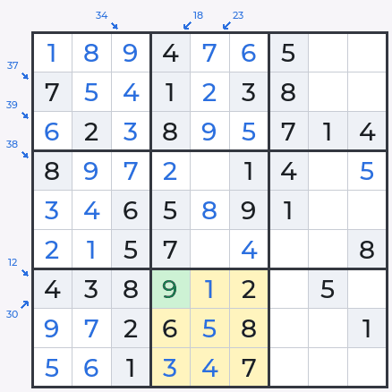

#### Step 32: the 4 in box 9

Box 9 needs a 4. r7c7 and r7c9: row 7 has one (r7c1). r8c7: column 7 has one (r4c7). r9c7, r9c8 and r9c9: row 9 has one (r9c5). Only **r8c8** is left: **r8c8 = 4**.

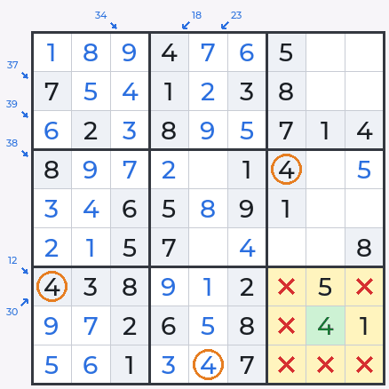

#### Step 33: the 3 in box 9

Box 9 needs a 3. r7c7 and r7c9: row 7 has one (r7c2). r9c7, r9c8 and r9c9: row 9 has one (r9c4). Only **r8c7** is left: **r8c7 = 3**.

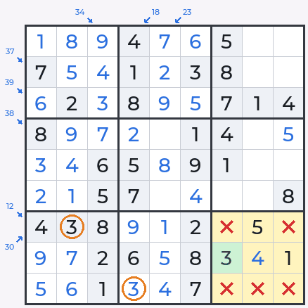

#### Step 34: the 3 in box 6

Box 6 needs a 3. r5c8 and r5c9: row 5 has one (r5c1). r6c7: column 7 has one (r8c7). r6c8: on its diagonal of 34 (with 9, 1, 9, 1 and 1 already on it), a 3 would leave 10 for its other cell, too much. Only **r4c8** is left: **r4c8 = 3**.

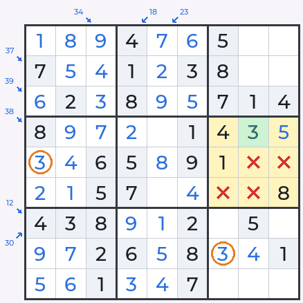

#### Step 35: the 3 in box 3

Box 3 needs a 3. r1c8: column 8 has one (r4c8). r2c8 and r2c9: row 2 has one (r2c6). Only **r1c9** is left: **r1c9 = 3**.

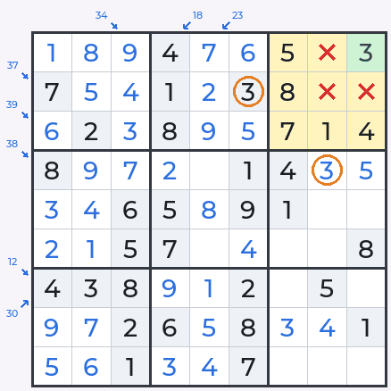

#### Step 36: the 2 in box 3

Box 3 needs a 2. r2c8 and r2c9: row 2 has one (r2c5). Only **r1c8** is left: **r1c8 = 2**.

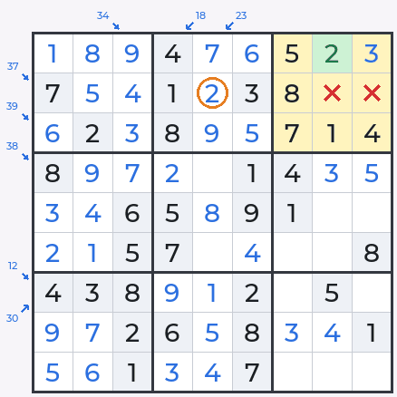

#### Step 37: the 3 in box 5

Box 5 needs a 3. r4c5: row 4 has one (r4c8). Only **r6c5** is left: **r6c5 = 3**.

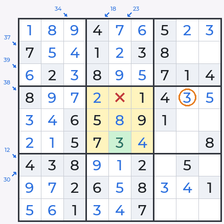

#### Step 38: the 6 in box 5

Box 5 needs a 6, and r4c5 is its last empty cell: **r4c5 = 6**.

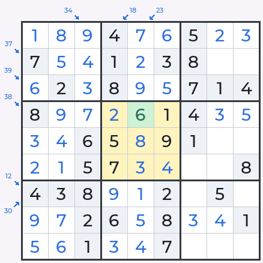

#### Step 39: the 2 in box 6

Box 6 needs a 2. r5c8: column 8 has one (r1c8). r6c7 and r6c8: row 6 has one (r6c1). Only **r5c9** is left: **r5c9 = 2**.

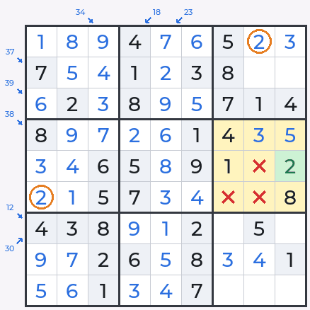

#### Step 40: the 7 in box 6

Box 6 needs a 7. r6c7 and r6c8: row 6 has one (r6c4). Only **r5c8** is left: **r5c8 = 7**.

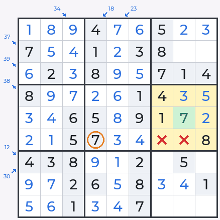

#### Step 41: the 2 in box 9

Box 9 needs a 2. r7c7 and r7c9: row 7 has one (r7c6). r9c8: column 8 has one (r1c8). r9c9: column 9 has one (r5c9). Only **r9c7** is left: **r9c7 = 2**.

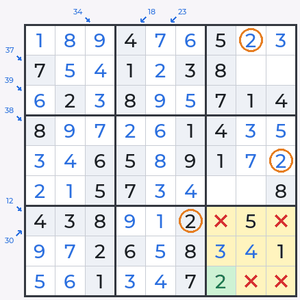

#### Step 42: the 7 in box 9

Box 9 needs a 7. r7c7: column 7 has one (r3c7). r9c8 and r9c9: row 9 has one (r9c6). Only **r7c9** is left: **r7c9 = 7**.

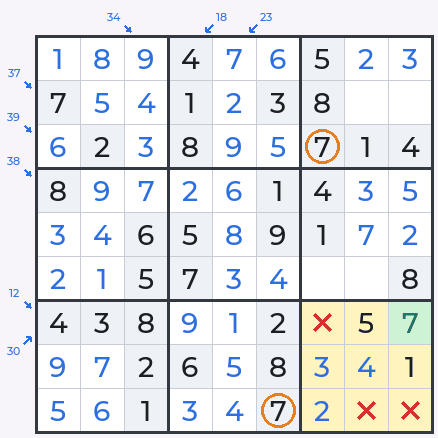

#### Step 43: the 9 in box 6

Box 6 needs a 9. r6c8: its diagonal of 34 (with 9, 1, 9, 1, 1 and 7 already on it) needs 6 there. Only **r6c7** is left: **r6c7 = 9**.

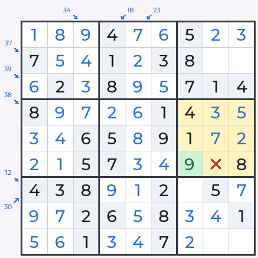

#### Step 44: the 6 in box 6

Box 6 needs a 6, and r6c8 is its last empty cell: **r6c8 = 6**.

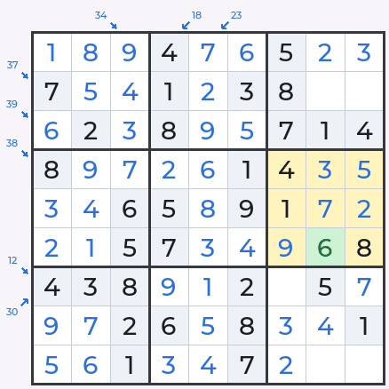

#### Step 45: the 6 in box 3

Box 3 needs a 6. r2c8: column 8 has one (r6c8). Only **r2c9** is left: **r2c9 = 6**.

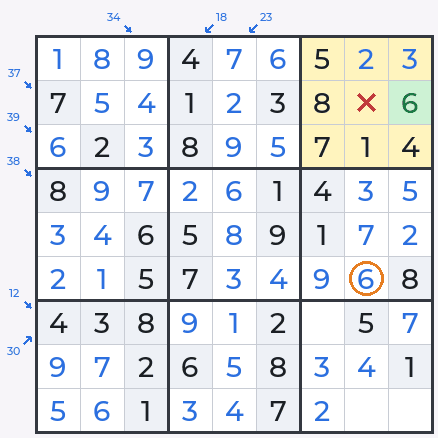

#### Step 46: the 9 in box 3

Box 3 needs a 9, and r2c8 is its last empty cell: **r2c8 = 9**.

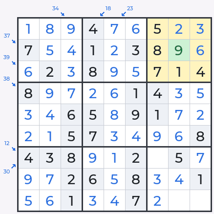

#### Step 47: the 6 in box 9

Box 9 needs a 6. r9c8 and r9c9: row 9 has one (r9c2). Only **r7c7** is left: **r7c7 = 6**.

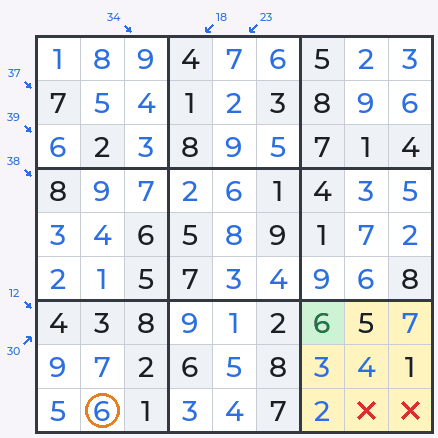

#### Step 48: the 8 in box 9

Box 9 needs an 8. r9c9: column 9 has one (r6c9). Only **r9c8** is left: **r9c8 = 8**.

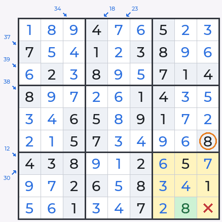

#### Step 49: the 9 in box 9

Box 9 needs a 9, and r9c9 is its last empty cell: **r9c9 = 9**.

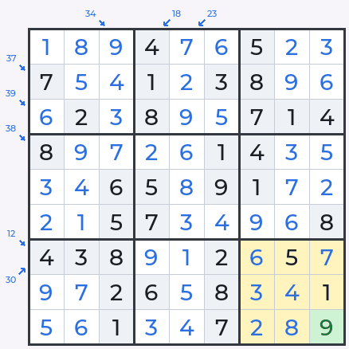

Solved.

<!-- /walkthrough -->
