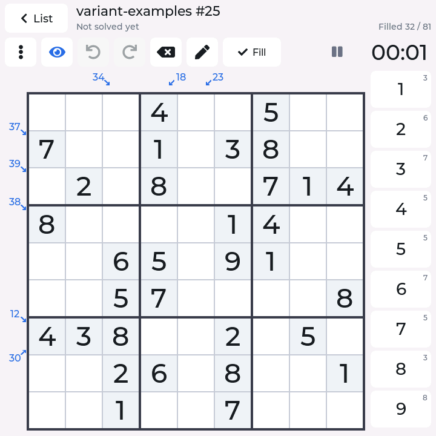

# Little Killer

[← All variants](README.md) · [Puzzles](../features-puzzles.md) · [How to play](../how-to-play.md)

## The rules

[Classic](classic.md) rules, and **clues outside the grid with a small arrow**: the **sum of the digits along that diagonal**, all the way to the edge. Digits **can repeat** on a diagonal (where the boxes allow it): unlike a Killer cage, a diagonal isn't a group of different digits.

## On the board

- Each clue is a small blue sum on the line between two cells, above the columns or left of the rows, with an arrow pointing into its diagonal's first cell: down-right or down-left from the top, down-right or up-right from the left.
- A diagonal whose digits add up to more than its clue, or (full) to anything else, turns red.
- The grader and hints narrow each cell of a diagonal by what its other cells can add up to: "This diagonal adds up to 34, so row 1, column 3 can only be 9".
- **Puzzles → ⋮ → New puzzle → Little Killer**: 8 diagonals (Hard and Expert 10) of 3 cells or more.

## How to solve it

- **Short diagonals first:** a diagonal of 3 cells adds up to at most 27 and at least 3 (with repeats), so a big or small sum pins its cells down.
- **Big sums need big digits:** with a sum of 34 over seven cells and only 3 placed, the rest must average high; a small digit can be impossible.
- **Repeats are allowed,** so don't use Killer's "different digits" combinations, only the sum: a diagonal of 3 with 27 is 9, 9, 9.
- When all cells but one are known, the last one is the sum minus the rest.

## Worked example

**variant-examples #25**, Little Killer Easy (see [Classic](classic.md#worked-example-the-whole-puzzle) for how to import the examples; cells are written r*row*c*column*). The clues are in the screenshot; one matters here: **34** above column 3, pointing down-right, along r1c3, r2c4, r3c5, r4c6, r5c7, r6c8 and r7c9.

**Step 1: r1c3, at the head of the 34.** Row 1 has 4 and 5; column 3 has 1, 2, 6 and 8; box 1 has 7. By the Classic rules r1c3 could be 3 or 9. Now the diagonal: r2c4, r4c6 and r5c7 are all 1s (repeats are fine here, they're in different boxes): 3 so far. If r1c3 were 3, its three other empty cells (r3c5, r6c8, r7c9) would have to make 34 − 3 − 3 = 28, and three digits make at most 27. **r1c3 = 9**.

**Step 2: the 8 in box 1.** Rows 2 and 3 have an 8 (r2c7, r3c4), and so does column 1 (r4c1): that rules out r2c2, r2c3, r3c1, r3c3 and r1c1. **r1c2 = 8**.

**Step 3: the 1 in box 1.** Rows 2 and 3 have a 1 (r2c4, r3c8): r2c2, r2c3, r3c1 and r3c3 are out. **r1c1 = 1**.

## The whole puzzle, step by step

<!-- walkthrough -->
<!-- Written by tools/walkthrough.py little-killer: edit the script, not this part. -->

The whole puzzle, from the start to the last cell: 49 steps, each one a single (one place left for a digit, or one digit left for a cell), taken in the order a box's single comes first, so not quite the order of the worked example above. Each step has a page of its own, with **Previous** and **Next**: pick one from the list below. In each picture, the unit the step looks at is tinted yellow (for a cell with one digit left: its row, column and box), the new digit is on green, the digits that rule cells out have an **orange ring**, and the empty cells they rule out a **red cross**. Givens are on grey, digits from earlier steps in blue.

1. [the 8 in box 1](little-killer/step-01.md)
2. [the 1 in box 1](little-killer/step-02.md)
3. [the 7 in box 2](little-killer/step-03.md)
4. [the 2 in box 2](little-killer/step-04.md)
5. [the 9 in box 2](little-killer/step-05.md)
6. [the 5 in box 2](little-killer/step-06.md)
7. [the 5 in box 1](little-killer/step-07.md)
8. [the 4 in box 1](little-killer/step-08.md)
9. [the 6 in box 1](little-killer/step-09.md)
10. [the 3 in box 1](little-killer/step-10.md)
11. [the 9 in box 1](little-killer/step-11.md)
12. [the 6 in box 2](little-killer/step-12.md)
13. [the 1 in box 4](little-killer/step-13.md)
14. [the 2 in box 4](little-killer/step-14.md)
15. [the 3 in box 4](little-killer/step-15.md)
16. [the 4 in box 4](little-killer/step-16.md)
17. [the 7 in box 4](little-killer/step-17.md)
18. [the 9 in box 4](little-killer/step-18.md)
19. [the 2 in box 5](little-killer/step-19.md)
20. [the 8 in box 5](little-killer/step-20.md)
21. [the 5 in box 6](little-killer/step-21.md)
22. [the 6 in box 7](little-killer/step-22.md)
23. [the 7 in box 7](little-killer/step-23.md)
24. [the 1 in box 8](little-killer/step-24.md)
25. [the 4 in box 8](little-killer/step-25.md)
26. [the 4 in box 5](little-killer/step-26.md)
27. [the 3 in box 8](little-killer/step-27.md)
28. [the 5 in box 8](little-killer/step-28.md)
29. [the 5 in box 7](little-killer/step-29.md)
30. [the 9 in box 7](little-killer/step-30.md)
31. [the 9 in box 8](little-killer/step-31.md)
32. [the 4 in box 9](little-killer/step-32.md)
33. [the 3 in box 9](little-killer/step-33.md)
34. [the 3 in box 6](little-killer/step-34.md)
35. [the 3 in box 3](little-killer/step-35.md)
36. [the 2 in box 3](little-killer/step-36.md)
37. [the 3 in box 5](little-killer/step-37.md)
38. [the 6 in box 5](little-killer/step-38.md)
39. [the 2 in box 6](little-killer/step-39.md)
40. [the 7 in box 6](little-killer/step-40.md)
41. [the 2 in box 9](little-killer/step-41.md)
42. [the 7 in box 9](little-killer/step-42.md)
43. [the 9 in box 6](little-killer/step-43.md)
44. [the 6 in box 6](little-killer/step-44.md)
45. [the 6 in box 3](little-killer/step-45.md)
46. [the 9 in box 3](little-killer/step-46.md)
47. [the 6 in box 9](little-killer/step-47.md)
48. [the 8 in box 9](little-killer/step-48.md)
49. [the 9 in box 9](little-killer/step-49.md)

Solved.

<!-- /walkthrough -->
