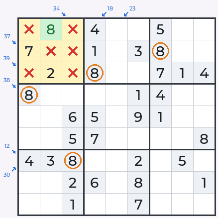

<!-- Written by tools/walkthrough.py little-killer: edit the script, not this page. -->
# Little Killer, step 1: the 8 in box 1

**Step 1 of 49** · [← The start](../little-killer.md#the-whole-puzzle-step-by-step) · [All steps](../little-killer.md#the-whole-puzzle-step-by-step) · [Step 2 →](step-02.md)

Box 1 needs an 8. r1c1: column 1 has one (r4c1). r1c3: column 3 has one (r7c3). r2c2 and r2c3: row 2 has one (r2c7). r3c1 and r3c3: row 3 has one (r3c4). Only **r1c2** is left: **r1c2 = 8**.

**Step 1 of 49** · [← The start](../little-killer.md#the-whole-puzzle-step-by-step) · [All steps](../little-killer.md#the-whole-puzzle-step-by-step) · [Step 2 →](step-02.md)
