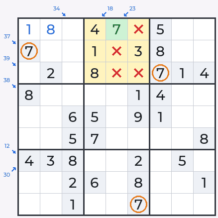

<!-- Written by tools/walkthrough.py little-killer: edit the script, not this page. -->
# Little Killer, step 3: the 7 in box 2

**Step 3 of 49** · [← Step 2](step-02.md) · [All steps](../little-killer.md#the-whole-puzzle-step-by-step) · [Step 4 →](step-04.md)

Box 2 needs a 7. r1c6: column 6 has one (r9c6). r2c5: row 2 has one (r2c1). r3c5 and r3c6: row 3 has one (r3c7). Only **r1c5** is left: **r1c5 = 7**.

**Step 3 of 49** · [← Step 2](step-02.md) · [All steps](../little-killer.md#the-whole-puzzle-step-by-step) · [Step 4 →](step-04.md)
