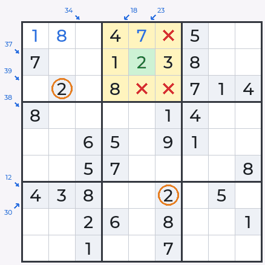

<!-- Written by tools/walkthrough.py little-killer: edit the script, not this page. -->
# Little Killer, step 4: the 2 in box 2

**Step 4 of 49** · [← Step 3](step-03.md) · [All steps](../little-killer.md#the-whole-puzzle-step-by-step) · [Step 5 →](step-05.md)

Box 2 needs a 2. r1c6: column 6 has one (r7c6). r3c5 and r3c6: row 3 has one (r3c2). Only **r2c5** is left: **r2c5 = 2**.

**Step 4 of 49** · [← Step 3](step-03.md) · [All steps](../little-killer.md#the-whole-puzzle-step-by-step) · [Step 5 →](step-05.md)
